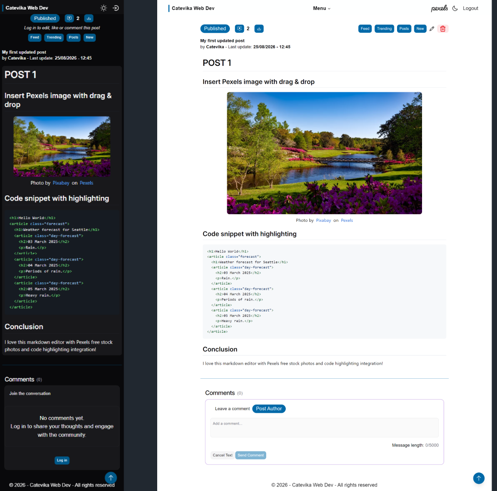

# 2026 Blog App - Frontend

Modern blog frontend built with **React 19, TypeScript, Tailwind CSS v4**, and **React Router v8**.  
Features a **Markdown editor**, **Pexels photo integration**, and **PDF generation** for posts.



## Table of contents <!-- omit from toc -->

- [2026 Blog App - Frontend](#2026-blog-app---frontend)
  - [Live demo](#live-demo)
  - [What this project does](#what-this-project-does)
  - [Features](#features)
  - [Tech stack](#tech-stack)
  - [Getting started](#getting-started)
    - [Prerequisites](#prerequisites)
    - [Install and run locally](#install-and-run-locally)
    - [Environment variables](#environment-variables)
  - [Architecture highlights](#architecture-highlights)
  - [Testing](#testing)
  - [Security \& best practices](#security--best-practices)
  - [Potential next steps](#potential-next-steps)
  - [How this fits my portfolio](#how-this-fits-my-portfolio)
  - [🧑‍💻 **Author**](#-author)

## Live demo

- **Demo:** [https://2026-catevika-blog-frontend.vercel.app/](https://2026-catevika-blog-frontend.vercel.app/)  
- **Backend API:** [https://github.com/Catevika/2026-blog-app-backend](https://github.com/Catevika/2026-blog-app-backend)

## What this project does

This is the frontend for a personal tech/blog platform where I:

- Browse and read blog posts rendered from Markdown
- Create and edit posts using an integrated **Markdown editor** with preview
- Attach **Pexels photos** to posts via the Pexels API
- Request and download a **PDF version** of a post, rendered by the backend with Puppeteer
- Handle authenticated actions (create/edit/delete posts) when logged in

It's designed to showcase **React + TypeScript** skills, component architecture, state management with Zustand, server state with React Query, and integration with external APIs.

## Features

- 📄 Post listing and detail pages with Markdown rendering
- ✍️ Markdown editor with live preview (`@uiw/react-md-editor`, `@uiw/react-markdown-preview`)
- 🖼️ Pexels photo search & selection for post images (`pexels` package)
- 📥 PDF export via the backend's Puppeteer-rendered export page
- 🧑‍💻 Auth-aware UI: different states for logged-in / logged-out users
- 🎨 Responsive, accessible UI with **Tailwind CSS v4** and **Shadcn/Radix UI** components
- ♿ Semantic HTML, focus states, alt text, keyboard navigation
- ⚙️ Typed API contracts, with Zod validation for authentication forms and Pexels responses
- 🔁 Server state management with **TanStack Query (React Query)**
- 🧠 Client state with **Zustand**

## Tech stack

- **Frontend:** React 19, TypeScript, Vite
- **Routing:** React Router v8
- **Styling:** Tailwind CSS v4 (`@tailwindcss/vite`), Shadcn/Radix UI, `class-variance-authority`, `tailwind-merge`, `clsx`
- **Server state:** TanStack Query (React Query) v5
- **Client state:** Zustand
- **Forms & validation:** React Hook Form + `@hookform/resolvers` + Zod
- **Markdown:** `@uiw/react-md-editor`, `@uiw/react-markdown-preview`, `remark-*`, `rehype-*`, KaTeX for math
- **HTTP client:** native `fetch` (via React Query)
- **Icons:** `react-icons`, `@hugeicons/react`
- **Testing:**
  - Unit / integration: **Vitest** + Testing Library
  - E2E: **Playwright**
- **Tooling:** ESLint, Prettier (with Tailwind plugin), TypeScript strict mode

## Getting started

### Prerequisites

- Node.js 24.14.1 or later
- npm
- A running backend and MongoDB instance for API-backed features; see the [backend README](https://github.com/Catevika/2026-blog-app-backend)

### Install and run locally

```bash
git clone https://github.com/Catevika/2026-catevika-blog-frontend.git
cd 2026-catevika-blog-frontend
npm install
cp .env.example .env
npm run dev
```

The app will be available at `http://localhost:5173` (or your Vite port).  
For local API requests, run the backend on port `4000`; Vite proxies `/api` requests there. Use `npm run dev:host` to expose the frontend on your local network.

### Environment variables

Set the following frontend variables in `.env`:

```env
VITE_API_URL=http://localhost:4000
VITE_PEXELS_API_KEY=your_pexels_api_key
```

`VITE_API_URL` is used for slug-availability checks; local `/api` requests are proxied by Vite. In production, set `VITE_API_URL` to the backend base URL. Vite variables are included in browser code, so do not put private credentials in them. The Pexels key is visible to clients; use a key appropriate for browser use.

## Architecture highlights

- **Components:** Reusable UI components under `src/components` (buttons, inputs, layout, markdown blocks, etc.).
- **Pages:** Route-level components in `src/pages` (post list, post detail, editor, auth pages).
- **API layer:** Typed fetch functions in `src/api`; Zod schemas validate authentication forms and Pexels responses.
- **Types:** Shared types/interfaces in `src/types` to keep API contracts explicit.
- **State:**
  - Server state: React Query hooks for posts, images, auth, etc.
  - Client state: Zustand stores for UI state, editor state, etc.
- **Hooks:** Custom hooks in `src/hooks` for data fetching, auth state, form handling, etc.

## Testing

- Unit / integration tests with **Vitest** + Testing Library:

  ```bash
  npm run test
  npm run test:ui       # Vitest UI
  npm run test:watch    # watch mode
  npm run coverage      # coverage report
  ```

- E2E tests with **Playwright**:

  ```bash
  npm run test:e2e
  ```

The Vitest suite in `tests/` covers:

- Post, comment, and image-upload API functions, including post creation,
  updates, deletion, restoration, likes, and favorites
- React Query hooks and custom hooks for posts, image uploads, PDF downloads,
  slug control, responsive layout, and theme behavior
- UI components for post editing, pagination, image uploads, Markdown links and
  images, likes, and threaded comments
- Route-level behavior for authentication, the dashboard, feed, post list, and
  post details
- Markdown math rendering with KaTeX for inline and display equations

The Playwright suite in `e2e/` covers browser workflows, including:

- Authentication and post creation, editing, deletion, restoration, and likes
- Comment creation and threaded replies, including edit, delete, and like
  actions on desktop and mobile
- Pexels photo search and PDF downloads, including PDF error handling

Run `npm run coverage` to generate the Vitest coverage report. It measures the
unit / integration suite; Playwright E2E results are reported separately and
are not included in that coverage percentage.

## Security & best practices

- No secrets in the repo; all config via environment variables.
- Strict TypeScript with explicit types for API data and Zod validation for authentication forms and Pexels responses.
- Input validation on forms with React Hook Form + Zod before sending to API.
- CORS and auth handled on the backend; frontend respects HTTP status codes and tokens.
- Markdown rendering uses sanitization (`rehype-sanitize`) and safe plugins.

## Potential next steps

- [ ] Add server-side rendering / meta tags for SEO (e.g. with a SSR framework or pre-rendering)
- [ ] Improve accessibility audit score (e.g. axe, Lighthouse)
- [ ] Add more comprehensive E2E coverage for auth and editor flows
- [ ] Further optimize bundle size and code-splitting

## How this fits my portfolio

This project demonstrates:

- Production-style React 19 + TypeScript codebase with modern tooling
- Thoughtful component design, state management (Zustand + React Query), and separation of concerns
- Integration with external APIs (Pexels) and a REST backend
- Attention to UX states, testing (Vitest + Playwright), and maintainability

It's intended as a reference implementation of how I structure and document a frontend app.

## 🧑‍💻 **Author**

Frontend developed by **Catevika**  
2026 Blog App — Full-stack project (React + Express + MongoDB)
